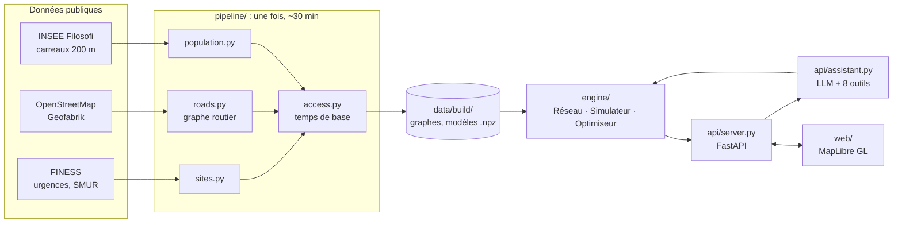

<div align="center">

# Accès Urgences

**Le temps de route réel jusqu'aux urgences, pour chaque habitant de France.<br>
Et une réponse chiffrée à la question : où un nouvel hôpital comptera-t-il le plus ?**

<a href="https://github.com/Bielorretto/map/releases/download/demo/acces-urgences-demo.mp4">
  
</a>

▶ **[Regarder la vidéo de démonstration](https://github.com/Bielorretto/map/releases/download/demo/acces-urgences-demo.mp4)** (2 min 16, 1080p)
· [sous-titres](https://github.com/Bielorretto/map/releases/download/demo/acces-urgences-demo.srt)
· [page de la release](https://github.com/Bielorretto/map/releases/tag/demo)

</div>

> [!IMPORTANT]
> **Une brique pour le projet Ju.N.I.Or**
>
> Nous avons contribué à la conception d'une brique qui pourrait être utilisée dans le
> projet **Ju.N.I.Or** (*Jumeau Numérique d'Impact sur l'Organisation des soins*), projet
> soutenu par Mme la ministre **Stéphanie Rist**.
>
> Ju.N.I.Or est l'un des chantiers de la
> [Stratégie intelligence artificielle et données de santé 2025-2028](https://health-data-hub.fr/sites/default/files/2025-12/strategie_donnees_de_sante_ia-2_0.pdf)
> du ministère de la Santé : un outil national de modélisation de l'organisation des soins,
> copiloté par la DGOS et l'Agence de l'innovation en santé et développé par Inria. Son but
> est d'appuyer la décision publique, nationale et territoriale, avec des données factuelles.
>
> Accès Urgences fait exactement cela pour l'accès aux urgences : il mesure, sur le vrai
> réseau routier, l'effet d'une ouverture, d'une fermeture ou d'un regroupement de service
> **avant** que la décision soit prise.

---

## Pourquoi cet outil

Quand chaque minute compte, la route jusqu'aux urgences peut tout changer. Or
**4,15 millions d'habitants vivent à 30 minutes ou plus d'un service d'urgences**,
le seuil de référence des politiques publiques d'accès aux soins urgents.

| Territoire | Habitants | À 30 min ou plus | Part |
|---|---:|---:|---:|
| Métropole | 62,6 M | 3,83 M | 6,1 % |
| Guadeloupe | 384 000 | 66 000 | 17 % |
| Martinique | 361 000 | 71 000 | 20 % |
| Guyane | 294 000 | 68 000 | 23 % |
| La Réunion | 890 000 | 17 000 | 2 % |
| Mayotte | 257 000 | 105 000 | 41 % |
| **Total** | **64,8 M** | **4,15 M** | **6,4 %** |

<sub>Calculé par le moteur sur le réseau routier OpenStreetMap, pour 603 services d'urgences et 462 SMUR (FINESS) et la population INSEE. Temps sans trafic.</sub>

Ouvrir un service d'urgences engage un territoire pour des décennies. Accès Urgences
permet d'en **mesurer l'effet avant de décider** : on pose un hôpital sur la carte et
on voit tout de suite combien d'habitants repassent sous les 30 minutes.

### Exemple : un hôpital en Essonne ou dans les Hautes-Alpes ?

| | Essonne | Hautes-Alpes |
|---|---:|---:|
| Habitants | 1 300 000 | 133 000 (10 fois moins) |
| À 30 min ou plus des urgences | 138 | 14 300 |
| Habitants ramenés sous 30 min par un nouvel hôpital | 138 au maximum | **6 196** (près de Serres) |

L'intuition dit « là où il y a le plus de monde ». Les temps de route réels disent
l'inverse : dans les Hautes-Alpes, le même hôpital a un **impact 45 fois plus grand**.
C'est le cas présenté dans la vidéo.

## Ce que fait l'application

- **La carte des temps.** Chaque point du territoire prend la couleur de son temps de
  route jusqu'aux urgences les plus proches : vert sous le quart d'heure, rouge au-delà
  de 30 minutes. La métropole et les cinq départements d'outre-mer sont couverts, en
  vue 2D ou en relief 3D.
- **Les chiffres clés et la recherche.** En haut : la part de la population sous 30 min,
  les habitants au-delà, le nombre d'urgences et de SMUR. La recherche trouve une
  commune, un hôpital ou une adresse et affiche son temps d'accès actuel.
- **Les zones prioritaires.** Les départements sont classés par nombre d'habitants loin
  des urgences. Un clic isole la zone.
- **La simulation en direct.** On glisse un hôpital sur la carte : la zone améliorée se
  recolore pendant le glisser, et le compteur affiche les habitants gagnés. Le bouton
  avant / après compare les deux situations.
- **L'optimisation.** Pour une zone, l'outil répond à « où placer *p* hôpitaux ? » et à
  « combien en faut-il pour passer tout le monde sous 30 min ? ». La solution est exacte.
- **L'assistant, le petit cœur.** On lui pose sa question en français (« Quels
  départements sont prioritaires ? », « Où placer 3 hôpitaux en Bretagne ? »). Il fait
  tourner le moteur, pose les hôpitaux sur la carte et cite la source de chaque chiffre.

## Pour qui

- **Agences régionales de santé et ministère** : préparer la carte de l'offre de soins
  et chiffrer l'effet d'une ouverture, d'un regroupement ou d'une fermeture.
- **Élus et collectivités** : objectiver un besoin local avec des chiffres vérifiables.
- **Chercheurs et journalistes** : explorer les inégalités d'accès, carreau par carreau.
- **Citoyens** : savoir à combien de minutes de route se trouvent les urgences.

## Des chiffres fiables

- **Uniquement des données publiques officielles** : FINESS (Ministère de la Santé),
  INSEE, OpenStreetMap, IGN.
- **Des temps validés** : 0,7 min d'écart moyen avec OSRM sur 60 trajets tirés au hasard,
  corrélation 0,992 (voir [Validation](#validation)).
- **Un résultat national cohérent** : 6,1 % de la population métropolitaine à 30 min ou
  plus, pour un ordre de grandeur publié par la DREES d'environ 6 %.
- **Un assistant qui n'invente rien** : il ne calcule pas lui-même. Chaque chiffre de sa
  réponse vient d'un outil du moteur et porte l'étiquette de sa source.

## Démarrer

Prérequis : Python 3.10 ou plus récent et `osmium-tool` (`brew install osmium-tool`).
Le pipeline télécharge environ 5 Go de données.

```bash
./pipeline/run_all.sh     # une fois : télécharge les données et calcule les modèles (~30 min)
./lancer.sh               # lance l'API + l'interface → http://localhost:8000
```

Pour activer l'assistant : `cp .env.example .env`, renseigner `OPENAI_API_KEY` ou
`ANTHROPIC_API_KEY`, puis relancer le serveur (voir [Assistant](#assistant-le-cœur)).

---

## Comment ça marche : le code

### Architecture



Le **pipeline** fait le travail lourd une seule fois : il construit le graphe routier,
place les urgences et la population, puis précalcule les temps de base. Au démarrage,
l'**API** recharge ces modèles en quelques secondes. Chaque interaction (glisser un
hôpital, optimiser, poser une question) ne recalcule ensuite que ce qui change.

### Arborescence

```text
pipeline/              Construction des données (lancé par run_all.sh)
  sites.py             1. urgences (SU, antennes) et SMUR depuis FINESS, géolocalisés
  roads.py             2. graphe routier orienté depuis OSM : découpage, sens uniques, vitesses
  population.py        3. carreaux INSEE de 200 m (métropole), communes (outre-mer)
  access.py            4. temps de base par territoire → data/build/modele_<T>.npz
  validation.py        5. comparaison trajet par trajet avec OSRM et l'IGN
  config.py            paramètres communs (seuil, territoires, projections, vitesses)
engine/                Moteur de calcul, utilisé par l'API
  reseau.py            graphe inversé (CSR scipy), accrochage au réseau (cKDTree), Dijkstra
  territoire.py        un territoire = réseau + sites + population + raster d'affichage
  dijkstra.py          Dijkstra élagué compilé avec numba (cœur de la simulation)
  simulation.py        effet d'un nouveau site : carreaux et pixels améliorés, indicateurs
  optimisation.py      MCLP / LSCP en programmation linéaire en nombres entiers (HiGHS)
api/
  server.py            routes FastAPI et service de l'interface
  assistant.py         assistant : boucle d'appels d'outils, flux SSE, sources
  recherche.py         barre de recherche : communes, établissements FINESS, adresses (BAN)
web/
  index.html           interface (panneaux en verre dépoli, cœur animé en SVG)
  app.js               carte MapLibre, rasters de temps, glisser-déposer, chat
tests/                 tests du moteur et de l'assistant (pytest)
```

### Les idées clés

#### 1. Un graphe inversé : un seul Dijkstra pour tout le pays

La question est « combien de temps pour aller *de chez moi* aux urgences les plus
proches ? ». Lancer un calcul par habitant serait trop lent. Le graphe est donc stocké
**inversé** (chaque tronçon u→v devient v→u, sens uniques respectés). Un seul Dijkstra
**multi-sources**, lancé depuis les 603 services à la fois, donne alors le temps de chaque
nœud du réseau vers le service le plus proche (`engine/reseau.py`) :

```python
dist, _, src = dijkstra(self.G, directed=True, indices=noeuds,  # noeuds = tous les services
                        min_only=True, limit=limite_s, return_predecessors=True)
```

Chaque carreau de population et chaque pixel de la carte est ensuite accroché au nœud
le plus proche (`cKDTree`), avec un temps d'approche à 20 km/h et un facteur de détour
de 1,3.

#### 2. Le Dijkstra élagué : une simulation exacte en 1 à 20 ms

Quand on pose un nouvel hôpital, on relance un Dijkstra depuis ce seul point, et on
**arrête l'exploration dès qu'un nœud n'est plus amélioré**. Si le nouveau site atteint
le nœud *v* en un temps ≥ T(v), le temps actuel, alors aucun nœud dont le trajet passe
par *v* ne peut être amélioré non plus. Le résultat est exact, mais l'exploration se
limite à la zone qui change : quelques milliers de nœuds au lieu de millions
(`engine/dijkstra.py`, compilé avec numba) :

```python
while tas:
    d, u = heapq.heappop(tas)
    if d > dist[u]:
        continue
    if d >= Tbase[u] or d > limite:   # u n'est pas amélioré : on n'explore pas au-delà
        continue
    sortie[n_out] = u; n_out += 1     # u fait partie de la zone améliorée
    for k in range(indptr[u], indptr[u + 1]):
        ...
```

C'est ce qui permet de recolorer la carte **pendant** le glisser.

#### 3. Une carte qui tient en octets

La carte des temps est un raster où **1 octet = minutes × 2** (résolution de 30 s,
254 = hors terre, 255 = sans route). Le navigateur le colore pixel par pixel dans un
`<canvas>` affiché comme source MapLibre. Une simulation ne renvoie qu'un **patch** :
le rectangle des pixels améliorés (`engine/simulation.py`). L'interface ne repeint que
ce rectangle, d'où l'animation fluide.

#### 4. L'optimisation : deux modèles classiques, résolus de façon exacte

`engine/optimisation.py` implémente deux modèles de localisation-couverture :

- **MCLP** (Church & ReVelle, 1974) : où placer *p* sites pour ramener le plus
  d'habitants sous le seuil ?
  max Σᵢ wᵢ yᵢ  avec  yᵢ ≤ Σ_{j ∈ Nᵢ} xⱼ  et  Σⱼ xⱼ = p ;
- **LSCP** (Toregas et al., 1971) : combien de sites au minimum pour que toute la
  population atteignable passe sous le seuil ?

Les candidats sont les centres de gravité de la population sur des mailles de 4 km.
Leur couverture Nᵢ se calcule par le même Dijkstra élagué, sur le vrai réseau. Le problème
est résolu en nombres entiers par HiGHS (`scipy.optimize.milp`), avec un algorithme
glouton en secours.

#### 5. L'assistant : un modèle de langage qui ne calcule rien

`api/assistant.py` donne au modèle (OpenAI ou Claude) huit outils qui appellent le moteur.
La boucle est simple : le modèle demande un outil, le serveur l'exécute, renvoie le
résultat, et recommence jusqu'à 8 fois. Chaque étape est diffusée en flux SSE à
l'interface : étapes, actions sur la carte, graphiques, sources, texte.

```python
for _ in range(MAX_APPELS):
    msg = ...                                     # réponse du modèle (en flux)
    appels = [b for b in msg.content if b.type == "tool_use"]
    if not appels:
        return                                    # réponse finale
    for b in appels:
        contenu, err = yield from self._appel(b.id, b.name, b.input, ctx)  # moteur + événements
    ...
```

Tous les chiffres viennent donc du moteur, et chaque outil déclare ses sources
([FINESS], [INSEE], [OSM], [OPTIM], [COMMUNES]).

### Tests

```bash
.venv/bin/python -m pytest tests/
```

---

## Données

Toutes les données sont publiques et réelles.

| Besoin | Source | Fichier |
|---|---|---|
| Services d'urgences (SU, antennes), SMUR, SAMU | FINESS : autorisations d'activités de soins « Médecine d'urgence », ancien format et nouveau format AMM (réforme 2023), Ministère de la Santé, data.gouv.fr | `finess_autorisations.csv`, `amm.xml` |
| Coordonnées des établissements | FINESS établissements géolocalisés (Lambert 93 / UTM DROM) | `finess_etab_geo.csv` |
| Population (métropole) | INSEE Filosofi 2021, carreaux de 200 m (2,3 M carreaux) | `filosofi_200m_2021.parquet` |
| Population (DROM) | Populations légales communales, placées à la mairie (geo.api.gouv.fr) | `communes_api.json` |
| Réseau routier | OpenStreetMap, extraits Geofabrik (France + 5 DROM) | `*.osm.pbf` |
| Limites administratives | Etalab / IGN Admin Express 2024 | `departements.geojson`, `regions.geojson` |

Destinations retenues : structures des urgences générales (SU) et antennes de
médecine d'urgence. Les urgences uniquement pédiatriques (SUP) sont exclues
du calcul « tout public » mais restent dans les données.

Graphe routier (`pipeline/roads.py`) : voies carrossables OSM, des autoroutes aux rues
résidentielles, découpées aux intersections et tous les 800 m, sens uniques et giratoires
respectés. Vitesse = `maxspeed × 0,8`, sinon profil par type de voie (valeurs du profil
voiture d'OSRM).

## Validation

`pipeline/validation.py` compare nos temps trajet par trajet avec OSRM et l'API
d'itinéraire IGN.

| Territoire | vs OSRM (écart absolu moyen) | Corrélation | vs IGN bdtopo-osrm |
|---|---|---|---|
| Métropole (60 trajets tirés au hasard, pondérés par la population) | 0,7 min (médiane −0,3) | 0,992 | IGN ≈ ×1,6 plus lent (corr. 0,945) |
| La Réunion (15 trajets) | 0,6 min | 0,993 | IGN ≈ ×1,5 plus lent |

Indicateur national obtenu : 6,1 % de la population métropolitaine à 30 min ou plus
d'un service d'urgences, cohérent avec l'ordre de grandeur publié par la DREES (~6 %).

Les temps sont « à vide » (sans trafic), comme OSRM. L'IGN applique des vitesses
plus prudentes. Un coefficient de calibration peut être ajouté si on vise le
distancier METRIC de l'INSEE.

## API

| Route | Rôle |
|---|---|
| `GET /api/init` | sites, statistiques par département / commune, métadonnées |
| `GET /api/raster/{T}.bin` | raster des temps (1 octet = minutes × 2 ; 254 hors terre ; 255 sans route) |
| `POST /api/impact` `{lon,lat}` | zone améliorée par un nouveau site (patch raster) |
| `POST /api/simulation` `{sites:[…]}` | indicateurs avec tous les sites simulés |
| `POST /api/optimisation` `{deps, mode:"mclp"\|"lscp", p}` | meilleures implantations |
| `POST /api/chat` `{question, historique, etat}` | assistant : flux SSE (étapes, actions sur la carte, graphiques, sources, texte) |
| `GET /api/recherche?q=` | barre de recherche : communes (INSEE), urgences/SMUR (FINESS), adresses et lieux-dits (BAN, IGN Géoplateforme), avec le temps d'accès actuel |

## Assistant (le cœur)

Un clic sur le cœur ouvre le chat. L'assistant (OpenAI `gpt-6-astra` par défaut, ou Claude
`claude-opus-5-5`) répond en une ou deux phrases. Le détail s'affiche en petits graphiques
sous la réponse, et la liste des sources s'affiche en bas avec leurs liens.

| Outil | Question type | Sur la carte |
|---|---|---|
| `classement_departements` | « Quels départements sont prioritaires ? » | ouvre le classement |
| `statistiques_zone` | « Temps moyen dans le Cantal ? » | isole la zone |
| `chercher_lieu` | « Hôpital le plus proche de Corte ? » | centre sur la commune |
| `simuler_hopitaux` | « Et si on ouvrait des urgences à Langogne ? » | pose l'hôpital |
| `optimiser_implantations` | « Où placer 3 hôpitaux en Bretagne ? » (MCLP) | pose les hôpitaux |
| `combien_hopitaux` | « Combien d'hôpitaux pour mettre la Lozère au vert ? » (LSCP) | pose les hôpitaux |
| `retirer_hopitaux` | « Retire le 2 » | retire |
| `chercher_etablissement` | « Où est l'hôpital Purpan ? » (FINESS) | centre sur l'établissement |

Configuration : `cp .env.example .env`, renseigner `OPENAI_API_KEY` (ou `ANTHROPIC_API_KEY`),
relancer le serveur. La clé reste côté serveur, dans `.env` (ignoré par git). Le modèle et
l'effort de raisonnement se règlent avec `ASSISTANT_MODELE` et `ASSISTANT_EFFORT`.

## Travailler à plusieurs

`main` est protégée : personne ne pousse directement dessus. Chacun travaille sur sa branche,
puis propose ses changements par une Pull Request, fusionnée après approbation de @Bielorretto
(voir `.github/CODEOWNERS`).

```sh
git switch main && git pull               # partir de la dernière version
git switch -c prenom/ma-modification     # sa propre branche
# … modifications, puis :
git add -A && git commit -m "Ce que fait la modification"
git push -u origin prenom/ma-modification
```

Ensuite, sur GitHub : **Compare & pull request** → vers `main`. Si `main` a bougé entre-temps :
`git switch main && git pull && git switch prenom/ma-modification && git merge main`.

Rappels : ne jamais versionner `.env` (clé API) ni `data/` (reconstruit par `./pipeline/run_all.sh`).
